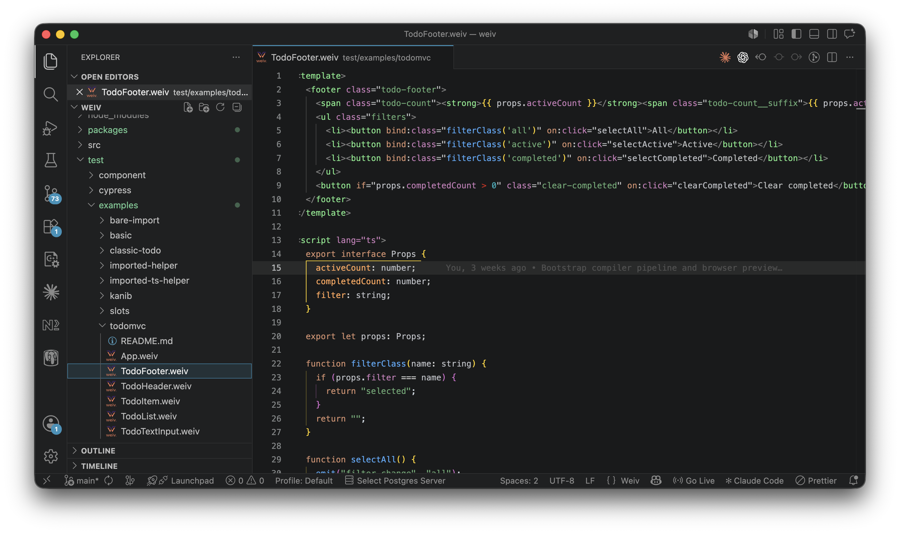

# Weiv for VS Code

VS Code support for `.weiv` single-file components.

This extension is maintained in the Weiv repository at
`packages/vscode-extension`.



## Features

- Language registration for `.weiv` files
- Embedded language support:
  - HTML in `<template>`
  - TypeScript in `<script lang="ts">`
  - CSS in `<style>`
- Weiv-specific highlighting:
  - `:prop` directive bindings
  - `@event` event handlers
  - `#if` / `#else` / `#for` control flow attributes
  - named `slot:name` directives
  - `{{ expression }}` template interpolation
  - PascalCase component tags (distinct from HTML tags)
- Bracket matching, auto-closing, and folding for section blocks
- Go to definition for imported components and script symbols used from templates
- TypeScript-backed completion, hover, signature help, and argument diagnostics
  for the component-provided `emit` helper in scripts.
  `emit` uses `export interface Emits` when one is declared.
- `.weiv` file icon support

## Install

If the extension is published in the VS Code Marketplace, install `Weiv` there.

## Local Build

```bash
npm install
npm run build
```

## Package A VSIX

```bash
npm run package
code --install-extension weiv-vscode-0.1.0.vsix
```

## Development

Open this repo in VS Code and press `F5` to launch an Extension Development
Host.
